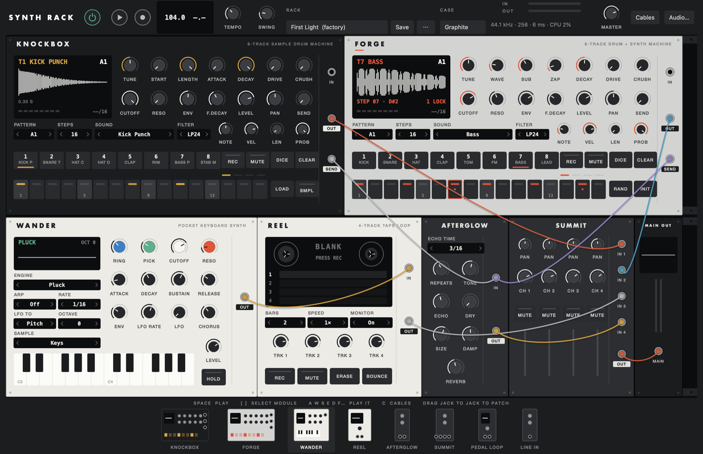

# Synth Rack

A portable synth and drum-machine studio for the laptop: a rack of modules you patch with cables,
play from the computer keyboard, and run next to (or through) the
[pedalboard](../pedalboard). No instruments or hardware needed.



`SPEC.md` is the working spec: what is built, how it fits together, and the backlog.
[`tutorials/`](tutorials/) has short walk-throughs.

## Run it

```
git clone git@github.com:feamster/synth-rack.git && cd synth-rack
./install.sh
synth-rack                              # --play starts the music straight away
```

`install.sh` builds the virtualenv and links the launcher into `~/.local/bin`, so `synth-rack`
works from any terminal. It is safe to run again, and all the link amounts to is
`ln -sf "$(pwd)/bin/synth-rack" ~/.local/bin/synth-rack`. To run without installing:
`.venv/bin/python src/main.py`.

The window opens and the terminal prompt comes straight back; anything the app prints goes to
`~/.synth-rack/last-run.log`. `synth-rack --fg` keeps it attached to the terminal instead.

Press **Space**. The factory rack *First Light* plays a groove on both drum machines. Click
anywhere on Wander (its name gets an underline: that module now has the keyboard) and play over
it on `A W S E D F T G Y H U J K`; `Z` / `X` change octave. The same keys play whichever
module you clicked last: on a drum machine they play the selected track chromatically.

## The modules

| | |
|---|---|
| **Knockbox** | 8-track sample drum machine. 30 built-in sounds; LOAD or drop a file to import your own; SMPL records whatever is patched into its IN jack. |
| **Forge** | 8-track drum + synth machine: Kick, Snare, Hat, Clap, Tom, FM, Bass, Lead, Chord, Noise. RAND rolls a new sound. |
| **Wander** | 6-voice keyboard synth: Stack, Pulse, FM, Pluck, Organ, Sample engines, arp, hold. |
| **Reel** | 4-track tape loop (1–8 bars) that records its IN jack in time with the transport. |
| **Afterglow** | Tempo-synced echo into reverb. Patch the SEND jacks here. |
| **Summit** | 4-channel mixer. |
| **Pedal Loop** | Runs one of your saved pedalboard boards inside the rack. |
| **Line In** | Your audio interface input (guitar, mic, the hardware Digitakt). |
| **Main Out** | What you hear. |

### Working the grooveboxes

- Click a step key to place a trig for the selected track. Track pads (or `1`–`8`) select and audition.
- **Parameter locks:** right-click (or shift-click) a step to hold it; it gets a red outline. Any
  sound knob you turn now applies to that step only, and NOTE / VEL / LEN / PROB edit that trig.
  Double-click a knob to drop its lock. Right-click the step again (or `Esc`) to let go.
- `R` or REC: live record. What you play on the pads or piano keys is quantised into the pattern.
- DICE rolls a pattern for the track; CLEAR clears it (Shift: the whole pattern).
- PATTERN changes wait for the end of the bar while playing, and both boxes follow each other
  (right-click a box → *Link Pattern Changes* to turn that off).
- Up to 64 steps in four pages: set STEPS, then use the small page lamps or `←` `→`.

### Patching

Drag from any jack to another. Outputs have a filled label. One output can feed many inputs and
an input sums everything plugged into it. Drag a cable's end off an input to unplug it, or
right-click a jack. Press `C` to dim or hide the cables when they are in the way.

### Saving and recording

- **Save** stores the rack (modules, knobs, patterns, cables) as a small JSON file. Racks are
  settings, not code, so they live outside this repo: see *Where your things are kept* below.
- **●** in the top bar records the main output to a `take-….wav`; Reel's BOUNCE writes the tape
  loop the same way. To change the folder, right-click ● → *Choose Recordings Folder…*, or use
  **Settings…**.

### Sounds and sample packs

Knockbox tracks and Wander's Sample engine play the 30 built-in sounds plus any audio files in
your samples folder. **A subfolder is a pack**: `Samples/808 Kit/Kick 1.wav` is the sound
"808 Kit / Kick 1".

- **Click the sound's name** on Knockbox (SOUND) or Wander (SAMPLE) to open the browser: packs on
  the left, sounds on the right, a search box that looks in every pack. Clicking a sound plays
  it on the track straight away, through that track's own settings and with the pattern still
  running. *Use* keeps it, *Cancel* puts the old one back.
- **Add Pack…** in the browser copies a whole folder of audio into your samples folder as a pack.
  **Add File…**, Knockbox **LOAD**, or dropping a file on Knockbox adds a single file. You can
  also just put folders into the samples folder in Finder; they show up on their own.
- The arrows on the sound's name step through the sounds in the current pack.
- To **rename or delete** a sample, right-click the Knockbox or Wander that is using it. Renames
  are followed through into your saved racks. The built-in sounds are synthesised, so they
  can't be renamed or deleted.

### Where your things are kept

This repo is the app only. A clone works on its own with the factory racks and built-in sounds;
nothing you make is stored in it.

| What | Where | Why |
|---|---|---|
| Racks | `~/src/gear-presets/synth-rack/` | small text files, in their own git repo so they have history |
| Samples and packs | `~/Dropbox/Synth Rack/Samples/` | audio is big; Dropbox syncs it to every Mac |
| Takes (● recordings, Reel bounces) | `~/Dropbox/Synth Rack/Takes/` | finished audio |
| Tape (what is on a rack's Reel) | `~/Dropbox/Synth Rack/Tapes/<rack>/` | audio that belongs to a rack |
| Session and settings | `~/.synth-rack/` | per machine |

- `gear-presets` is a separate repo checked out **beside this one** (it also holds the
  pedalboard's boards; see its README). Every Save makes a local git commit there, so each rack
  has a history; push it when you want it backed up. Without that checkout, racks go to
  `~/.synth-rack/racks` and move over the first time the app starts with it in place.
  `GEAR_PRESETS=/path` points somewhere else.
- Without Dropbox, the audio folders are under `~/Music/Synth Rack/`.
- **Settings…** lets you add more folders to look in for samples and for racks, and choose which
  one new files are saved in. Things are found by name, in the order listed, main folder first.
  A rack names its samples ("808 Kit / Kick 1") and never stores a path, so the same rack works
  on any Mac that has the pack. A rack loaded from an extra folder is saved back where it came
  from. These choices are per machine (`~/.synth-rack/settings.json`).

### Knobs

Drag up or down to turn; hold Shift for fine steps; scroll works too. **Double-click or
Option-click a knob to put it back to its default.** Click the **tempo** knob to type a tempo
(Option-click for 120). [tutorials/00-cheat-sheet.md](tutorials/00-cheat-sheet.md) lists every
gesture and key.

## With the pedalboard

- **Inside the rack:** add *Pedal Loop*, choose a board, patch through it. It reads
  `../pedalboard/boards` and never writes there.
- **Into the pedalboard app:** Settings… → output to *BlackHole 2ch*, then choose BlackHole as the
  pedalboard's Live Input.
- **Guitar into the rack:** add *Line In* and patch it. Settings… sets the input device and channel.

## License

Apache 2.0, see `LICENSE`.

## Develop

```
.venv/bin/python -m pytest && .venv/bin/ruff check .
```
